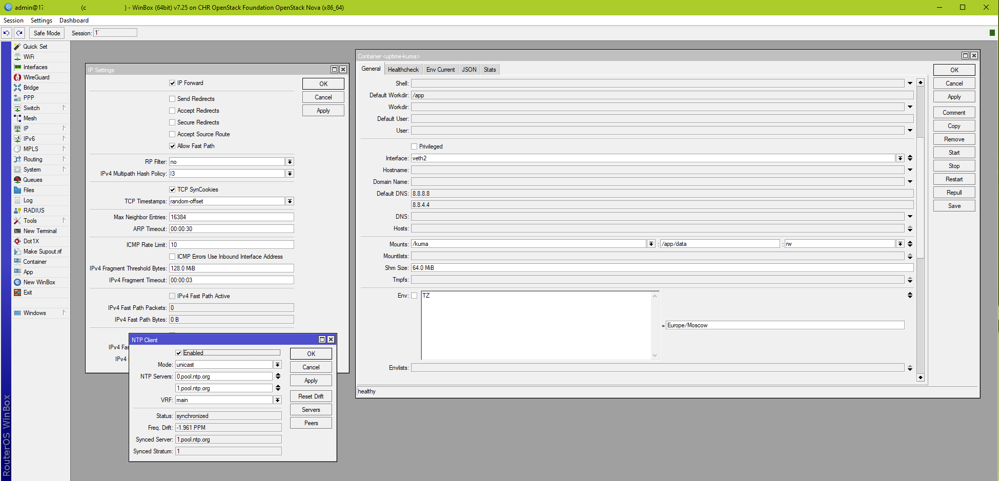
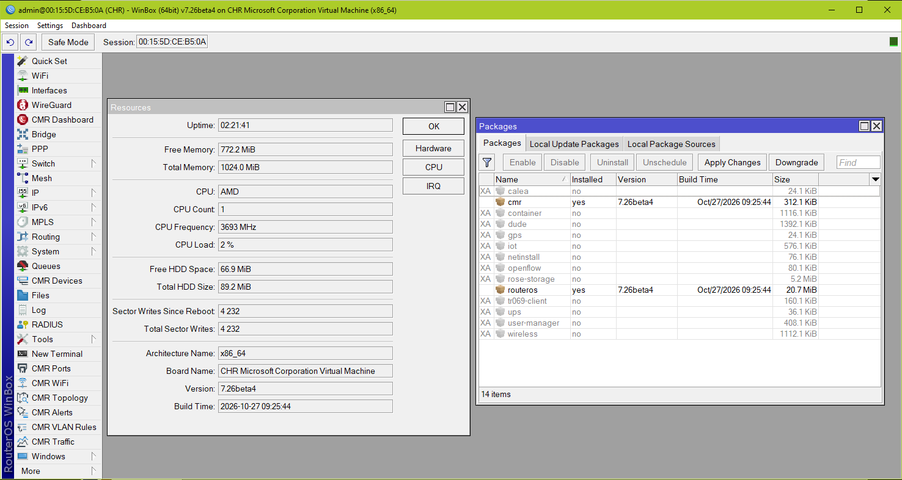

# WinBox 3.43 for RouterOS 7.25+ (binary patch)

**WinBox 3.43** is the last release of the classic WinBox 3.x client. It works fine with
RouterOS up to 7.24.x, but **RouterOS 7.25 breaks it**: the client either refuses to connect
or crashes while loading the interface. MikroTik's answer is "upgrade to WinBox 4.x" — this
project instead patches the original `winbox64.v3.43.exe` so it keeps working with 7.25.

The builds are fully deterministic: the scripts apply **surgical byte patches**
(v1: 12 patches, 282 bytes, all inside `.text`; v2 adds the `.wbox` section;
v3 adds three more tweaks; v4 adds two converter blobs assembled from source
with the real GNU toolchain; v5 adds initial RouterOS 7.26/CMR support) and verify
every result
against a known-good SHA-256. Each output is **byte-identical** to the
community-tested patched build of the corresponding lineage.

This repository currently ships **patch sets v1 through v5**. The patch
pipeline is deterministic and self-verifying, so
if a future RouterOS release breaks WinBox 3.43 again, further patch sets can
be added the same way as new versions.

| File | SHA-256 |
|---|---|
| `winbox64.v3.43.exe` (original, input) | `5b41cf51fd81e8d082687f6b522159cf4aba22e6df8edc486721d4e09507b6e9` |
| `winbox64.v3.43p1.exe` (patch set v1) | `acfc8034b662cdabd4ead6a590194a2274dc41358f1b0cda71db9a752b2c4ea4` |
| `winbox64.v3.43p2.exe` (patch set v2) | `8b0bc24fcfdbd7eee6109d4593ad3aedecb4fc28786133acc71ed051c61aea20` |
| `winbox64.v3.43p3.exe` (patch set v3) | `4c7223fdf60eb4293db413db712aa89a786180eff7074398630dfc21c6f29d6a` |
| `winbox64.v3.43p4.exe` (patch set v4) | `4b861b5a0508df19b93b888453a1072e94c8feddd760a3a6f7fa864c8b1de1dd` |
| `winbox64.v3.43p5.exe` (patch set v5) | `84999acf0cc20179ab8e77d0cb16e0cabd4fd756aafcebf946e790cc783016a7` |

## Contents

* [What changed in RouterOS 7.25 and why WinBox 3.43 breaks](#what-changed-in-routeros-725-and-why-winbox-343-breaks)
* [Patch set v1 — startup compatibility](#patch-set-v1--startup-compatibility)
* [Patch set v2 — embedded icons + version stamp](#patch-set-v2--embedded-icons--version-stamp)
* [Patch set v3 — Win11 launch fix + Switch icon + Format Drive guard](#patch-set-v3--win11-launch-fix--switch-icon--format-drive-guard)
* [Patch set v4 — bytes/bigbytes value editors](#patch-set-v4--bytesbigbytes-value-editors)
* [Patch set v5 — RouterOS 7.26 / initial CMR support](#patch-set-v5--routeros-726--initial-cmr-support)
* [Roadmap / TODO](#roadmap--todo)
* [Build](#build)
* [CI / Releases](#ci--releases)
* [Donations](#donations)
* [Disclaimer](#disclaimer)

## Screenshot





## Credits

This project — the reverse-engineering analysis of the WinBox 3.43 binary, the complete
patch set, the deterministic build script, the CI pipeline and this documentation —
was created with the assistance of the AI model **GLM-5.3**.

## What changed in RouterOS 7.25 and why WinBox 3.43 breaks

* The login reply advertises a minimum WinBox version of **4.3** — the *client* rejects the
  session itself, although the server is still perfectly able to speak the old protocol.
* Skins stored on the router were regenerated (by WinBox 4.x / the `user` service) with new
  JSON constructs that crash WinBox 3's skin parser.
* The `.jg` menu-descriptor generator dropped redundant `title` fields (minification), so
  WinBox 3 calls `strlen(NULL)` in three different places.
* New field types (`bigfixedpoint`, `bignumberrange`), a new conv type (`u32_u32vector`)
  and new constructs in the Power Cycle dialog (id-less `multinumber` field,
  `multicmdsrc` reference-by-slot-number) hit WinBox 3's intentional asserts.

The patches below make the frozen WinBox 3 parser tolerant to all of this — the same
approach MikroTik themselves took in WinBox 4.2 ("ignore all RouterOS WinBox file parsing
errors"), plus a fallback for the dropped `title` fields.

## Patch set v1 — startup compatibility

All offsets are file offsets (`VMA − 0x400C00`); "cave" = hand-written code placed into
dead assert/log blocks.

| # | Location (VMA) | What it does | Trade-off |
|---|---|---|---|
| 1 | `0x4FA51C` | Ignore the server-advertised minimum WinBox version (`jbe` → `jmp`) | none |
| 2 | `0x4FA991` | Always take the built-in "no skin" branch instead of downloading the router skin | user skins/layouts from the router are not loaded |
| 3 | `0x4A7945` + cave `0x4FD931` | Menu parser: `title ?: name` fallback before `strlen` | none |
| 4 | `0x4A28AA`, `0x49DCB8` | Unknown field types are skipped (instead of an assert crash); unknown conv types degrade to the `u32_u32` handler | NTP windows lose 9 `bigfixedpoint` / 1 `bignumberrange` fields; Power Cycle / Format Drive pre-fill may not work |
| 5 | `0x4A3799` + cave `0x49DD4A` | Guard id-less `multinumber` fields: NULL id → full frame unwind → field skipped | none |
| 6 | `0x4837A0` | Defuse the `SlotRef … slot not found` assert → graceful exit | none |
| 7 | `0x4A1426` + cave `0x483724` | Check for the `id` property **before** any allocation; skip id-less fields cleanly. A return-address guard rejects accidental entries into the cave | the Interfaces column in the Power Cycle dialog is not built |
| 8 | `0x4A0DFC` + cave `0x49DD6F` | Field-parser entry guard: if called with a small integer (7.25 resolves `multicmdsrc` by slot number, not node pointer) → return NULL → field skipped | none |
| 9 | `0x492DEE` | Defuse the `no slot found for cond` assert → return NULL via the function epilogue | none |
| 10 | `0x484862` + cave `0x49DD85` | Skip NULL holes in the window children array left by the skip in #7 (the indexer would write to `0+0x18`) | none |
| 11 | `0x4A7420` + cave `0x483781` | Menu index builder (opening tabs): the same `title ?: name` fallback; the leftover original builder call is nop'd out | none |
| 12 | `0x4A7119` | QuickSet: third consumer of `title` → reuse the same fallback cave | none |

## Patch set v2 — embedded icons + version stamp

Patch set v2 = patch set v1 plus everything needed to make the patched client a
single self-contained file (consolidated from the whole icon-integration
development series into one deterministic build step, `build-patched-v2.py`):

* **New RWX section `.wbox`** (RVA `0x238000`, 0x20000 bytes, appended after
  `.reloc`) holding a 472-byte startup extractor and the three icon sprites
  (`icons16/24/32.png`, byte-identical to the RouterOS 7.24.5 webfig files).
* **Startup icon extraction**: `AddressOfEntryPoint` is redirected to the
  extractor. Before the original `mainCRTStartup` runs, it unpacks the three
  PNGs to `%TEMP%\icons16/24/32.png` (plain KERNEL32 calls:
  `GetTempPathA`/`CreateFileA`/`WriteFile`/`CloseHandle`) and wires the icon
  loader's built-in fallback structures (`VirtualProtect` on the read-only
  `.rdata` globals, P-slots/Q-structures in `.wbox`). WinBox then finds its
  icons regardless of the working directory — no files needed next to the exe.
* **Version stamp**: window titles and the VERSIONINFO resource
  (FileVersion/ProductVersion, Details tab) show `3.43.102.38`, so the patched
  build is easily distinguishable from a stock 3.43.
* **Authenticode signature is dropped** (unavoidable: the image grows and the
  certificate no longer matches); the Security directory entry is zeroed and
  the checksum cleared.

Trade-offs: the file grows from 2,295,976 to 2,418,176 bytes; SmartScreen may
warn about the unsigned binary. Patch set v1 remains available for anyone who
prefers the minimal patch and placing the three PNG files next to the exe.

## Patch set v3 — Win11 launch fix + Switch icon + Format Drive guard

Patch set v3 (`build-patched-v3.py`) is built **on top of patch set v2** and
adds three functional tweaks plus a new version stamp (lineage v83 of the
community patch):

* **Win11 launch fix**: the `.wbox` entry wrapper gets `sub/add rsp,8`
  around its frame, so `rsp` is 16-byte aligned at WinAPI calls — without it
  Windows 11 crashes with `MOVAPS` inside `CreateFileA` during the icon
  extraction (the PNG-table `lea` disp and the final `jmp` are re-aimed
  accordingly).
* **Format Drive NULL-guard** (`.text` cave): a NULL pointer in the
  Format Drive / Power Cycle dialog path returned garbage and crashed the
  client; the guard makes it return safely instead.
* **Switch icon (CHR)**: a 120-byte lazy `getIcon` blob in `.wbox`
  (basis `0x638300`) with the icon slot re-pointed to it — fixes the empty
  Switch icon on CHR routers (looks up glyph 24 when the item name is
  `Switch`, caches the result).
* **Version stamp**: window titles and VERSIONINFO show `3.43.102.83`.

Trade-offs: same as v2 (unsigned, 2,418,176 bytes); `VS_FIXEDFILEINFO`
keeps the v2 value, matching the reference build.

## Patch set v4 — bytes/bigbytes value editors

Patch set v4 (`build-patched-v4.py`) is built **on top of patch set v3** and
restores the two value editors that RouterOS 7.24+ broke (lineage v98 of the
community patch):

* **`bytes` fields (u32)** — the field that triggered the analysis is
  *IPv4 → Settings → Fragment Threshold*: the
  router stopped sending the `bytes` field converter, so WinBox 3.43 shows
  such fields red and silently discards every edit (the defect affects all
  writable bytes fields). The patch wires the converter's empty parse/commit
  slots to a hand-written parser that accepts the WinBox4 grammar
  (KiB/MiB/GiB/TiB binary, k/M/G/T decimal, bare `B`, empty = 0, clamped
  to 0xFFFFFFFF).
* **`bigbytes` fields (u64)** — the Container one: *Container → Shm Size*,
  plus the other 64-bit fields (tmpfs/memory
  limits, disk file size/offset): the 64-bit variant of the same problem;
  a separate u64 parser + commit stub restores editing.
* **Version stamp**: window titles and VERSIONINFO show `3.43.102.98`.

The two converter blobs are **not hardcoded**: their assembly sources
(`bytes_impl.S`, `bigbytes_impl.S`) are assembled with the real GNU toolchain
(`as` + `ld -Ttext` + `objcopy`) by `build-blobs.py` into `bytes_impl.bin` /
`bigbytes_impl.bin`, which `build-patched-v4.py` then loads — run
`build-blobs.py` first (it needs binutils: preinstalled on Linux/CI, WSL or
MinGW on Windows). The blobs are not verified separately; the final exe is
verified as a whole by its SHA-256. The converter bridges and the rest of
the value-commit chain are left untouched.

Trade-offs: same as v3 (unsigned, 2,418,176 bytes).

## Patch set v5 — RouterOS 7.26 / initial CMR support

Patch set v5 (`build-patched-v5.py`) is built **on top of patch set v4** and
makes WinBox 3.43 usable against RouterOS 7.26 with the `cmr` package
installed. Four layers, all inside
`.text` hooks + `.wbox` caves:

* **CMR table model-unfolding**: RouterOS 7.26+CMR wraps the table
  properties (`path`, `c:` with the columns) into a `model:{...}` node; the
  'table' handler only looked for them on the node itself → zero columns →
  crash (AV `0x47c65e`) right after connect. A hook in the property loop
  reroutes unknown properties to a cave that unwraps `model` nodes and
  re-enters the loop head (`path`/`c` keep working natively).
* **Dashboard NULL-resource guard**: the virtual selector of Dashboard
  objects returns NULL/dangling; a cave skips the resource read when the
  selector result is NULL (AV `0x49705b` on opening the CMR Dashboard).
* **Dashboard child validation**: children fed to the notify loop carry a
  child-array instead of an `nv::string`; borrowing that garbage string
  corrupted the heap. The cave validates the string (non-NULL, inner
  pointer in the heap window, sane length) before the borrow and exits
  through the function epilogue on failure.
* **CMR menu icons**: 9 icons rasterized from the webfig 7.26 inline-SVG
  CSS into cells 48, 49, 52–58 (row 1) of the embedded sprites
  (`icons16/24/32-cmr.png`); the sprites are replaced in place inside
  `.wbox` — the new PNGs are smaller, the rest of each zone is
  zero-padded (the PNG parser stops at IEND; the startup extractor's size
  table stays valid).

No version-stamp change. Trade-offs:
same as v4 (unsigned, 2,418,176 bytes).

This is a *stability* fix, not full CMR support: the WinBox 3 parser still
does not know the CMR field/container types — see the Roadmap.

## Build

Requirements: the original `winbox64.v3.43.exe` in the repo root, PowerShell
(for patch set v1) and Python 3 (for patch sets v2–v5). Patch set v4
additionally needs GNU binutils (`as`/`ld`/`objcopy`) for `build-blobs.py`
(preinstalled on Linux; on Windows use WSL or MinGW-w64) — run it before
`build-patched-v4.py`. Patch set v5 needs the CMR sprite sources
`icons16/24/32-cmr.png` (committed to the repository).

```powershell
./build-patched-v1.ps1        # -> winbox64.v3.43p1.exe  (compatibility patches only)
python ./build-patched-v2.py  # -> winbox64.v3.43p2.exe  (v1 + icons + version stamp)
python ./build-patched-v3.py  # -> winbox64.v3.43p3.exe  (v2 + Win11/Switch/FD fixes)
python ./build-blobs.py       # assemble bytes/bigbytes converter blobs (GNU as, required for v4)
python ./build-patched-v4.py  # -> winbox64.v3.43p4.exe  (v3 + bytes/bigbytes editors)
python ./build-patched-v5.py  # -> winbox64.v3.43p5.exe  (v4 + RouterOS 7.26/initial CMR support)
```

Each patch set takes the previous output as its input. All
scripts:

1. verify the input hash (fails on anything but the pristine original);
2. assert the expected original bytes before **every** write (fails safely on a wrong offset);
3. apply their patches;
4. verify the output hash and write the result.

## CI / Releases

`.github/workflows/build-and-release.yml` runs on **every push to `master`**
(and manually via `workflow_dispatch`): it builds all five patch sets on an
Ubuntu runner — where the real GNU assembler turns `bytes_impl.S` /
`bigbytes_impl.S` into the v4 converter blobs — verifies all SHA-256
hashes, and creates five GitHub
Releases on the first successful run (existing releases are left untouched —
the builds are byte-deterministic, so there is nothing to update):

* **`patched-v1`** — `WinBox 3.43p1`: `winbox64.v3.43p1.exe` +
  `icons16/24/32.png` (the PNGs must sit next to this exe)
* **`patched-v2`** — `WinBox 3.43p2`: `winbox64.v3.43p2.exe` only —
  self-contained, icons embedded
* **`patched-v3`** — `WinBox 3.43p3`: `winbox64.v3.43p3.exe` only —
  self-contained, Win11/Switch/Format Drive fixes
* **`patched-v4`** — `WinBox 3.43p4`: `winbox64.v3.43p4.exe` only —
  self-contained, plus the bytes/bigbytes editor fixes
* **`patched-v5`** — `WinBox 3.43p5` (marked *Latest*): `winbox64.v3.43p5.exe`
  only — self-contained, plus RouterOS 7.26/initial CMR support

## Roadmap / TODO

Known remaining issues in the patched client — candidates for a future
patch set (v6):

* **Container UI bug with `ENV`** — the container element with `ENV`
  variables renders incorrectly.
* **Tools → Ping in ARP mode** — does not work against current RouterOS.
* **WiFi: sends `interworking.realms-raw=""` on save** — saving a WiFi
  object submits an empty `interworking.realms-raw`.
* **CMR component (RouterOS 7.26+)**:
  - ~~fix launch crash on cmr package installed~~ fixed in patch set 5
  - implement full CMR support: the WinBox 3 parser still does not know
    the CMR field/container types (`slot`, `tags`, `enmbools`, `bargraph`,
    `query`, `deck`, `topolayout`, `supportmsgid`, `defenum`), so the CMR
    windows render with a degraded/generic UI — patch set 5 only prevents
    the crashes.

## Donations

If this patch saved you from a forced migration to WinBox 4.x, you can
support the project:

* **USDT (TRC-20)**: `TWLXmDdmaCEG8URAs3qi1pLitdHWTCHmAj`
* **Ethereum (ETH / ERC-20)**: `0xd5D9C69d390571FF0d2C166A4Fd384585Ef17F36`

## Disclaimer

WinBox is proprietary MikroTik software. The original binary is included here only as the
input of the patch, unmodified; the patch itself is a small interoperability fix for
RouterOS 7.25. Use at your own risk.

