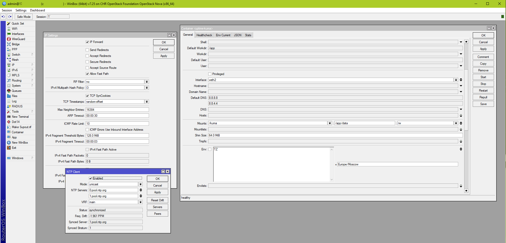
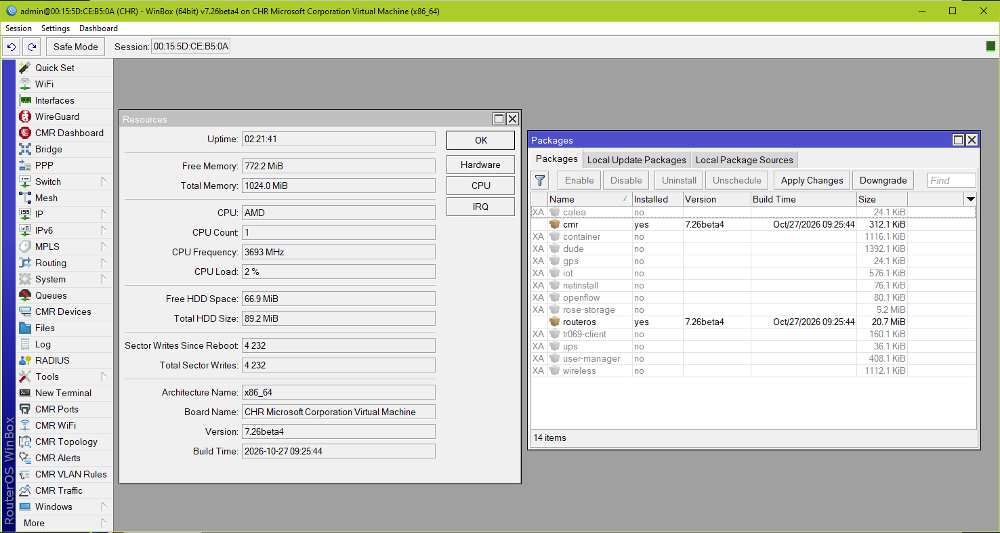

# WinBox 3.43 for RouterOS 7.25+ (binary patch)

**WinBox 3.43** is the last release of the classic WinBox 3.x client. It works fine with
RouterOS up to 7.24.x, but **RouterOS 7.25 breaks it**: the client either refuses to connect
or crashes while loading the interface. MikroTik's answer is "upgrade to WinBox 4.x" — this
project instead patches the original `winbox64.v3.43.exe` so it keeps working with 7.25 —
and along the way it also fixes several older WinBox 3 bugs that show up on RouterOS
7.2x and earlier.

## Contents

* [Features](#features)
* [Screenshot](#screenshot)
* [What changed in RouterOS 7.25/7.26 and why WinBox 3.43 breaks](#what-changed-in-routeros-725726-and-why-winbox-343-breaks)
* [Roadmap / TODO](#roadmap--todo)
* [Build](#build)
* [CI / Releases](#ci--releases)
* [Donations](#donations)
* [Disclaimer](#disclaimer)

## Features

Everything below is already included in the latest patch set; the per-set
breakdown lives in the [CHANGELOG](CHANGELOG.md).

* **Connects to RouterOS 7.25+ at all** — the login reply advertises a
  minimum WinBox version of 4.3; the client-side check is bypassed,
  plus the necessary graceful degradations to connect
  - relevant since ROS 7.25
* **The skins parser is disabled** — router skins regenerated by
  WinBox 4.x carry JSON constructs the WinBox 3 parser cannot digest;
  the client takes its built-in no-skin branch instead
  - relevant since ROS 7.25
* **Icons are embedded inside the exe** — the standard set, the Switch
  icon and the CMR menu icons
  - relevant since ROS 7.25
* **CMR works** — the CMR tables, the Dashboard and its field types
  render properly again
  - relevant since ROS 7.26 with the `cmr` package
* **NTP Client → Peers** — the `Time`/`Offset`/`Delay`… fields
  (`bigfixedpoint`) render again
  - relevant since ROS 7.25
* **Routing → Num Set → Range fields** — Apply no longer rejects the
  Range input with "num range not specified": the field became
  `bignumberrange` on 7.25+, a type the client cannot assemble; an
  in-memory jg transformation serves a two-`bignumber` tuple instead
  - relevant since ROS 7.2x
* **Routing → Settings → Policy Rules** — no red mark on the first
  open, Apply works
  - relevant since ROS 7.2x
* **Tools → Ping, Tools → Traceroute** — the `Interface`/`VRF` fields
  MikroTik themselves dropped in RouterOS
  7.2x are back
  - relevant since ROS 7.2x
* **IPv4 → Settings → Fragment Threshold** (and every writable `bytes`
  field) — the `bytes` parsing and apply functionality is restored
  - relevant since ROS 7.2x
* **Container → Shm Size** (and the other 64-bit `bigbytes` fields) —
  the `bigbytes` parsing and apply functionality is restored
  - relevant since ROS 7.2x
* **Container → ENV** — the broken corner TZ widget of the ENV element
  is hidden (DPI-invariant)
  - relevant for all ROS versions
* **ESR usability pack** (by [teslasystems](https://github.com/teslasystemsx)) — Ctrl+wheel zoom, the
  dynamic-version window title, Log Entry selection, the filter-value
  swap fix, counters grouping ("8 589 934 747")
  - relevant for all ROS versions
* **WiFi → Configuration** — saving no longer submits an
  empty value of `interworking.realms-raw`
  - relevant for all ROS versions
* **"Use UTF-8" option** — a compatibility layer for the non-English
  data WinBox 4 writes (Russian list comments, a Russian WiFi SSID):
  UTF-8 ↔ ACP conversion at the M2 boundary, OFF by default = stock
  behavior
  - relevant for all ROS versions

## Screenshot





## Credits

This project — the reverse-engineering analysis of the WinBox 3.43 binary, the complete
patch set, the deterministic build script, the CI pipeline and this documentation —
was created with the assistance of the AI model **GLM-5.3**.

The **ESR usability set** (Ctrl+wheel zoom, Stats ≥ 10^9 with
thousands grouping, Log Entry selection and the filter-value swap fix)
originates from the
community build by **MikroTik Forum** user
[@teslasystems](https://forum.mikrotik.com/u/teslasystems)
([GitHub](https://github.com/teslasystemsx)) — see the topic
[WinBox v3.43 ESR bugfixes/improvements](https://forum.mikrotik.com/t/winbox-v3-43-esr-bugfixes-improvements/270398).

## What changed in RouterOS 7.25/7.26 and why WinBox 3.43 breaks

* The login reply advertises a minimum WinBox version of **4.3** — the *client* rejects the
  session itself, although the server is still perfectly able to speak the old protocol.
* Skins stored on the router were regenerated (by WinBox 4.x / the `user` service) with new
  JSON constructs that crash WinBox 3's skin parser.
* The `.jg` menu-descriptor generator dropped redundant `title` fields (minification), so
  WinBox 3 calls `strlen(NULL)` in three different places.
* New field types (`bigfixedpoint`, `bignumberrange`), a new conv type (`u32_u32vector`)
  and new constructs in the Power Cycle dialog (id-less `multinumber` field,
  `multicmdsrc` reference-by-slot-number) hit WinBox 3's intentional asserts
  (the new field types are displayed properly since patch set v8).

**RouterOS 7.26** (with the `cmr` package installed) adds its own breakage —
again not a protocol change, but UI-model constructs the frozen WinBox 3
parser cannot digest, so the *original* client crashes or renders a degraded
UI against 7.26:

* Table properties (`path`, the `c:` with the columns) are wrapped into a
  `model:{…}` node; the 'table' handler only looks for them on the node
  itself → zero columns → a NULL-array clone crash right after connect.
* The virtual selector of Dashboard objects returns NULL/dangling pointers
  → crash on opening the CMR Dashboard.
* Children fed to the notify loop carry a child-array where WinBox 3
  expects an `nv::string` → borrowing that garbage string corrupts the heap.
* New CMR field/container types (`slot`, `tags`, `enmbools`, `bargraph`,
  `query`, `deck`, `topolayout`, `supportmsgid`, `defenum`) are unknown to
  the WinBox 3 parser → intentional asserts / degraded generic rendering
  (`enmbools` and `tags` are handled properly since patch set v7, the rest
  still render generically).
* The CMR menus come with their own icon set, unknown to the embedded
  sprite tables.

The patches below make the frozen WinBox 3 parser tolerant to all of this — the same
approach MikroTik themselves took in WinBox 4.2 ("ignore all RouterOS WinBox file parsing
errors"), plus a fallback for the dropped `title` fields.

## Build

Requirements: the original `winbox64.v3.43.exe` in the repo root, PowerShell
(for patch set v1) and Python 3. Patch sets need GNU
binutils (`as`/`ld`/`objcopy`, preinstalled on Linux; on Windows use WSL or
MinGW-w64): they assemble their cave/converter blobs from the sources in the
`asm/` folder themselves (v7 also loads the 340B `icons/cmr_icons.bin` stab
data). Patch set v5 needs the CMR sprite sources
`icons/icons16/24/32-cmr.png` (committed to the repository).

```powershell
./build-patched-v1.ps1        # -> winbox64.v3.43p1.exe  (compatibility patches only)
python ./build-patched-v2.py  # -> winbox64.v3.43p2.exe  (v1 + icons + version stamp)
python ./build-patched-v3.py  # -> winbox64.v3.43p3.exe  (v2 + Win11/Switch/FD fixes)
python ./build-patched-v4.py  # -> winbox64.v3.43p4.exe  (v3 + bytes/bigbytes editors)
python ./build-patched-v5.py  # -> winbox64.v3.43p5.exe  (v4 + RouterOS 7.26/initial CMR support)
python ./build-patched-v6.py  # -> winbox64.v3.43p6.exe  (v5 + WiFi/ENV fixes + ESR usability set)
python ./build-patched-v7.py  # -> winbox64.v3.43p7.exe  (v6 + CMR improvements + dynamic title + Ping fields)
python ./build-patched-v8.py  # -> winbox64.v3.43p8.exe  (v7 + Win7 launch + NTP/Range display + Apply fix + heap shield)
python ./build-patched-v9.py  # -> winbox64.v3.43p9.exe  (v8 + Policy Rules fix + in-memory Ping/TR fields)
python ./build-patched-v10.py # -> winbox64.v3.43p10.exe (v9 + ESR grouping fix + 7.24.5 connection fix)
python ./build-patched-v11.py # -> winbox64.v3.43p11.exe (v10 + ESR counter grouping + Use UTF-8 option)
```

Each patch set takes the previous output as its input. All
scripts:

1. verify the input hash (fails on anything but the expected base — the
   pristine original for v1/v2, the previous patch set's output for v3–v7);
2. assert the expected original bytes before **every** write (fails safely on a wrong offset);
3. apply their patches;
4. verify the output hash and write the result.

## CI / Releases

`.github/workflows/build-and-release.yml` runs on **every push to `master`**
(and manually via `workflow_dispatch`): it builds all eleven patch sets on an
Ubuntu runner — where the real GNU assembler assembles the cave/converter
sources from the `asm/` folder — verifies all SHA-256
hashes, and creates eleven GitHub
Releases on the first successful run (existing releases are left untouched —
the builds are byte-deterministic, so there is nothing to update):

* **`patched-v1`** — `WinBox 3.43p1`: `winbox64.v3.43p1.exe` +
  `icons16/24/32.png` (the PNGs must sit next to this exe)
* **`patched-v2`** — `WinBox 3.43p2`: `winbox64.v3.43p2.exe` only —
  self-contained, icons embedded
* **`patched-v3`** — `WinBox 3.43p3`: `winbox64.v3.43p3.exe` only —
  self-contained, Win11/Switch/Format Drive fixes
* **`patched-v4`** — `WinBox 3.43p4`: `winbox64.v3.43p4.exe` only —
  self-contained, plus the bytes/bigbytes editor fixes
* **`patched-v5`** — `WinBox 3.43p5`: `winbox64.v3.43p5.exe`
  only — self-contained, plus RouterOS 7.26/initial CMR support
* **`patched-v6`** — `WinBox 3.43p6`: `winbox64.v3.43p6.exe`
  only — self-contained, plus the WiFi/ENV fixes and the ESR usability set
* **`patched-v7`** — `WinBox 3.43p7`: `winbox64.v3.43p7.exe`
  only — self-contained, plus the CMR improvements, the dynamic-version
  title and the Ping/Traceroute dialog fields
* **`patched-v8`** — `WinBox 3.43p8`: `winbox64.v3.43p8.exe`
  only — self-contained, plus the Win7 launch fix, the NTP/Range field
  display, the Num Set → Apply fix and the stronger heap shield
* **`patched-v9`** — `WinBox 3.43p9`: `winbox64.v3.43p9.exe`
  only — self-contained, plus the Policy Rules fix and the in-memory
  Ping/Traceroute fields
* **`patched-v10`** — `WinBox 3.43p10`: `winbox64.v3.43p10.exe`
  only — self-contained, plus the ESR number-grouping revert and the
  RouterOS 7.24.5 connection fix
* **`patched-v11`** — `WinBox 3.43p11` (marked *Latest*): `winbox64.v3.43p11.exe`
  only — self-contained, plus the ESR grouping of read-only counters and
  the "Use UTF-8" option

## Roadmap / TODO

Known remaining issues in the patched client — candidates for a future
patch set:

* **WB4 (WinBox 4.x) Channel 6 protocol** — the new session protocol of
  WinBox 4: an 8-state machine, a hello with the username,
  challenge-response, curve25519-like cryptography (32B ephemeral
  keys), HMAC (20B key) + cipher (16B key), encryption from the very
  first byte and a 24-sessions-per-user limit.
* **CMR component (RouterOS 7.26+)**:
  - implement the `bargraph` field type;
  - implement `topolayout`;
  - implement WinBox 4-style filter icons;
  - verify in a real environment.
* **Dark theme** — WinBox 3.43 is light-theme only. A dark mode would need
  a skin/colour-table rework of the built-in UI (the no-skin branch forced
  by patch v1-#2) or a patched default skin with dark palettes for the
  window, tree, list and editor controls.
* **filter value disable / clear** (from the teslasystems ESR set) — needs
  some fixes (the rebased filter-value swap corridor from patch set 6 does
  not fully handle the disable/clear interaction yet).
* **256×256 application icon** — integrate a 256×256 icon as the
  application icon (the original WinBox 3.43 ships only up to 48×48, which
  looks blurry at modern high-DPI Explorer/taskbar sizes).

## Donations

If this patch saved you from a forced migration to WinBox 4.x, you can
support the project:

* **USDT (TRC-20)**: `TWLXmDdmaCEG8URAs3qi1pLitdHWTCHmAj`
* **Ethereum (ETH / ERC-20)**: `0xd5D9C69d390571FF0d2C166A4Fd384585Ef17F36`

## Disclaimer

WinBox is proprietary MikroTik software. The original binary is included here only as the
input of the patch, unmodified; the patch itself is an interoperability fix for
RouterOS 7.25+ (plus a set of bug fixes for older versions). Use at your own risk.

